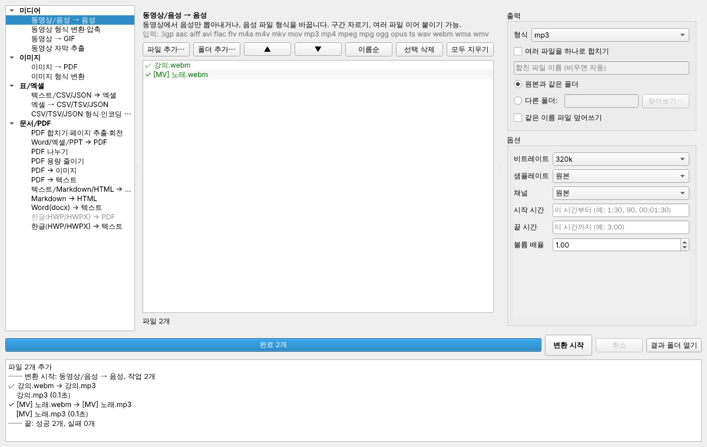

# fileconv — 만능 파일 변환기

동영상·음성, 이미지·PDF, 텍스트·엑셀, 문서(PDF/Word/한글) 변환을 **하나의 프로그램**으로 처리합니다.
창(GUI)으로 파일을 끌어다 놓아 변환하거나, 명령줄(`fconv`)로 여러 파일을 한 번에 변환할 수 있습니다.

- Windows 중심으로 만들었고 macOS/Linux 에서도 동작합니다
- ffmpeg 가 함께 설치되므로 따로 설치할 프로그램이 거의 없습니다 (Word → PDF 만 MS Office 또는 LibreOffice 필요)
- 한글 CSV(cp949) 인코딩 자동 감지, 한글 글꼴 PDF, 한글(HWP/HWPX) 문서 지원



---

## 지원하는 변환

| 분류 | 변환 | 이름 | 입력 → 출력 | 여러 파일 합치기 |
|---|---|---|---|---|
| 미디어 | 동영상/음성 → 음성 | `to-audio` | mp4 mkv avi mov wmv webm … / mp3 wav m4a … → **mp3 wav aac m4a flac ogg opus** | O (이어 붙이기) |
| | 동영상 형식 변환·압축 | `video-convert` | mp4 mkv avi mov webm gif … → **mp4 mkv webm mov avi** | |
| | 동영상 → GIF | `video-to-gif` | 동영상 → **gif** | |
| | 동영상 자막 추출 | `subtitle-extract` | mkv mp4 … → **srt ass vtt** | |
| 이미지 | 이미지 → PDF | `images-to-pdf` | jpg png webp bmp gif tiff heic → **pdf** | O (기본) |
| | 이미지 형식 변환·크기·회전·흑백 | `image-convert` | jpg png webp bmp gif tiff heic ico → **jpg png webp bmp gif tiff ico** | |
| 표/엑셀 | 텍스트/CSV/JSON → 엑셀 | `text-to-excel` | txt csv tsv json → **xlsx** | O (파일마다 시트) |
| | 엑셀 → CSV/TSV/JSON | `excel-to-text` | xlsx xlsm → **csv tsv json** | |
| | CSV/TSV/JSON 형식·인코딩 변환 | `table-convert` | txt csv tsv json → **csv tsv json** | |
| 문서/PDF | PDF 합치기·페이지 추출·회전·암호 | `pdf-tools` | pdf → **pdf** | O (기본) |
| | Word/엑셀/PPT → PDF | `office-to-pdf` | docx doc rtf odt xlsx xls pptx ppt … → **pdf** | |
| | PDF 나누기 | `pdf-split` | pdf → **pdf** (여러 개) | |
| | PDF 용량 줄이기 | `pdf-compress` | pdf → **pdf** | |
| | PDF → 이미지 | `pdf-to-image` | pdf → **png jpg webp** | |
| | PDF → 텍스트 | `pdf-to-text` | pdf → **txt** | |
| | 텍스트/Markdown/HTML → PDF | `text-to-pdf` | txt md html → **pdf** | |
| | Markdown → HTML | `markdown-to-html` | md → **html** | |
| | Word → 텍스트 | `docx-to-text` | docx → **txt md** | |
| | 한글(HWP/HWPX) → 텍스트 | `hwp-to-text` | hwp hwpx → **txt** | |
| | 한글(HWP/HWPX) → PDF | `hwp-to-pdf` | hwp hwpx → **pdf** (한컴오피스 필요) | |

`fconv list` 로 언제든 최신 목록을 볼 수 있고, `fconv info <이름>` 으로 각 변환의 옵션을 볼 수 있습니다.

---

## 가장 쉬운 방법 — 실행 파일만 내려받기 (Python 설치 불필요)

1. GitHub 저장소 페이지 → **Actions** 탭 → 맨 위(가장 최근)의 초록색 ✓ **CI** 실행을 누릅니다.
2. 아래쪽 **Artifacts** 에서 **FileConverter-windows** 를 내려받아 압축을 풉니다.
3. 폴더 안의 **FileConverter.exe** 를 실행합니다. (명령줄은 같은 폴더의 `fconv.exe`)

> 처음 실행할 때 "Windows의 PC 보호" 파란 창이 뜨면 **추가 정보 → 실행** 을 누르세요.
> 코드 서명을 하지 않은 프로그램이라 뜨는 경고입니다.
> Actions 의 파일은 90일 뒤 지워지므로, 오래 보관하려면 압축 파일을 따로 저장해 두세요.

## 설치 (Windows, Python 으로 직접 실행)

1. **Python 3.11 이상** 설치: <https://www.python.org/downloads/>
   설치 첫 화면에서 **"Add python.exe to PATH"** 를 꼭 체크하세요.
2. 이 저장소를 내려받습니다 (GitHub 에서 *Code → Download ZIP* 후 압축 풀기, 또는 `git clone`).
3. 그 폴더에서 PowerShell 또는 명령 프롬프트를 열고:

```bash
python -m venv .venv
```

```bash
.venv\Scripts\activate
```

```bash
pip install -e .
```

이제 `fconv` 명령과 `fconv-gui` 프로그램을 쓸 수 있습니다. (새 창을 열 때마다 `.venv\Scripts\activate` 를 먼저 실행)

> **Word/엑셀/PPT → PDF** 는 MS Office 가 설치되어 있으면 그것을 쓰고, 없으면 무료인
> [LibreOffice](https://ko.libreoffice.org) 를 씁니다. 둘 다 없으면 이 변환만 "사용 불가"로 표시됩니다.
> **한글 → PDF** 는 한컴오피스 한글이 설치된 Windows 에서만 됩니다 (글자만 뽑는 **한글 → 텍스트** 는 어디서나 가능).

---

## 사용법 — 창(GUI)

```bash
fconv gui
```

1. 파일(또는 폴더)을 가운데 목록에 **끌어다 놓으면** 알맞은 변환이 자동으로 선택됩니다.
   다른 변환을 원하면 왼쪽 목록에서 고르세요.
2. 오른쪽에서 **출력 형식**과 **옵션**을 정합니다. 옵션에 마우스를 올리면 설명이 나옵니다.
3. **[변환 시작]** — 진행률이 표시되고, 끝나면 **[결과 폴더 열기]** 로 바로 확인할 수 있습니다.

- 이미지 → PDF 처럼 순서가 중요할 때는 목록에서 **끌어서 순서를 바꾸거나** ▲▼ / [이름순] 버튼을 쓰세요.
- 회색으로 표시된 파일은 현재 변환에서 지원하지 않는 형식이라 건너뜁니다.
- 마지막으로 쓴 변환, 저장 폴더, 변환별 옵션(예: MP3 비트레이트)은 기억됩니다. (비밀번호는 저장하지 않음)
- 변환 중에 창을 닫으면 지금 하던 작업을 취소하고, 끝나는 대로 닫힙니다.

**탐색기 "보내기" 메뉴에 추가하기 (Windows)**: `fconv sendto` 를 한 번 실행하면, 탐색기에서 파일을 선택하고
마우스 오른쪽 → **보내기 → 파일 변환기** 로 바로 열 수 있습니다. (`fconv sendto --remove` 로 제거)

## 사용법 — 명령줄

```bash
fconv convert 강의.mp4 -t mp3
```

```bash
fconv convert 강의.mp4 -t mp3 -O bitrate=320k -O start=1:30 -O end=5:00
```

```bash
fconv convert "사진\*.jpg" -t pdf --merge -o 앨범.pdf
```

```bash
fconv convert 고객목록.csv -t xlsx
```

```bash
fconv convert 1월.csv 2월.csv 3월.csv -t xlsx --merge -o 1분기.xlsx
```

```bash
fconv convert 보고서.pdf 부록.pdf -t pdf --merge -o 합본.pdf
```

```bash
fconv convert 보고서.pdf -t pdf -u pdf-split
```

```bash
fconv convert 스캔본.pdf -t pdf -u pdf-compress -O image_quality=50
```

```bash
fconv convert 계약서.pdf -t pdf -O new_password=1234
```

```bash
fconv convert 녹음1.m4a 녹음2.m4a 녹음3.m4a -t mp3 --merge -o 전체녹음.mp3
```

```bash
fconv convert 보고서.pdf -t png -O dpi=200 -O pages=1-3
```

```bash
fconv convert 동영상폴더 -t mp4 -O resolution=720p -O quality=보통 -o 압축본/
```

| 옵션 | 뜻 |
|---|---|
| `-t, --to` | 출력 형식 (확장자) |
| `-o, --output` | 출력 파일 또는 폴더 (기본: 원본과 같은 폴더) |
| `-m, --merge` | 여러 파일을 하나로 합치기 |
| `-O, --opt 이름=값` | 변환 옵션 (여러 번 가능, `fconv info <이름>` 으로 확인) |
| `-u, --using` | 변환기를 직접 지정 (예: `pdf-split`) |
| `-r, --recursive` | 폴더를 주면 하위 폴더까지 |
| `--overwrite` | 같은 이름 파일이 있으면 덮어쓰기 (원본 파일은 절대 덮어쓰지 않음) |
| `--dry-run` | 실제로 바꾸지 않고 결과 파일 이름만 미리 보기 |

**문제가 생기면** `fconv doctor` 를 실행해 보세요. ffmpeg·LibreOffice·MS Office·한컴오피스 설치 여부와
PDF 에 쓰일 한글 글꼴, 사용할 수 없는 변환과 그 이유를 한눈에 보여줍니다.

- 같은 이름의 파일이 이미 있으면 `이름 (1).mp3` 처럼 새 이름으로 저장합니다.
- 변환 중 실패하거나 취소하면 만들다 만 파일은 남지 않습니다.
- Windows 명령 프롬프트에서도 `*.jpg` 같은 와일드카드를 그대로 쓸 수 있습니다.
- 폴더를 통째로 넣으면 바꿀 수 없는 파일(desktop.ini, Thumbs.db, 다른 형식 파일 등)은 건너뛰고 알려줍니다.

---

## 실행 파일(.exe) 만들기

Python 이 없는 PC 에서도 쓸 수 있게 폴더 하나로 묶습니다.

```bash
powershell -ExecutionPolicy Bypass -File scripts\build_windows.ps1
```

결과: `dist\FileConverter\FileConverter.exe` (창 프로그램), `dist\FileConverter\fconv.exe` (명령줄),
그리고 옮기기 쉬운 `dist\FileConverter-windows.zip`. ffmpeg 도 함께 들어 있습니다.

GitHub 에 올리면 **Actions** 탭의 CI 가 Windows 에서 테스트를 돌리고 `FileConverter-windows` 압축 파일을 만들어 둡니다.

---

## 프로젝트 구조

```
src/fileconv/
├── core/            변환 엔진 (CLI·GUI 공용)
│   ├── base.py      Option(옵션 선언) · Job(작업) · Converter(변환기 부모 클래스)
│   ├── registry.py  변환기 등록/검색 (@register)
│   ├── engine.py    작업 계획(plan) · 실행(run) · 출력 경로 규칙 · 임시 파일 처리
│   ├── tools.py     ffmpeg / LibreOffice / MS Office 찾기
│   └── utils.py     와일드카드·자연 정렬·인코딩 감지·파일 이름 충돌 처리
├── converters/      실제 변환기들 (media, image, table, document, hangul)
├── cli/main.py      명령줄 프로그램 fconv
└── gui/             PySide6 창 프로그램
tests/               pytest 테스트 (샘플 파일은 테스트가 직접 만듦)
packaging/           PyInstaller 설정 (.exe 만들기)
```

## 새 변환기 추가하기

`converters/` 아래 파일에 클래스 하나만 추가하면 **CLI 와 GUI 에 자동으로 나타납니다**.
옵션도 `Option(...)` 으로 선언만 하면 CLI 의 `-O 이름=값` 과 GUI 입력 칸이 자동으로 생깁니다.

```python
@register
class MyConverter(Converter):
    name = "my-convert"                 # CLI 에서 쓰는 이름
    title = "무엇 → 무엇"                # GUI 에 보이는 이름
    category = "document"               # media / image / table / document
    description = "설명"
    inputs = frozenset({"abc"})
    outputs = frozenset({"xyz"})
    default_output = "xyz"
    options = (Option("level", "int", 5, "강도", "1~10", min=1, max=10),)

    def convert(self, job: Job) -> list[Path]:
        src = job.inputs[0]
        ...                              # job.output 에 결과 저장
        job.progress(0.5)                # 진행률 (취소 요청도 여기서 확인됨)
        return [job.output]
```

새 파일을 만들었다면 `converters/__init__.py` 의 import 줄에 추가하세요.

## 테스트

```bash
pip install -e ".[dev]"
```

```bash
pytest -q
```

테스트용 동영상·이미지·한글 CSV·PDF·Word 파일은 테스트가 실행될 때 직접 만들어 쓰므로 저장소에 바이너리 파일이 없습니다.

## 라이선스 참고

이 프로젝트가 쓰는 주요 라이브러리는 모두 자유롭게 쓸 수 있는 라이선스(MIT/BSD/Apache/LGPL)입니다.
함께 설치되는 ffmpeg 실행 파일은 GPL 빌드이므로, `.exe` 를 **다른 사람에게 배포**할 때는 ffmpeg 의 GPL 고지가 필요합니다.
